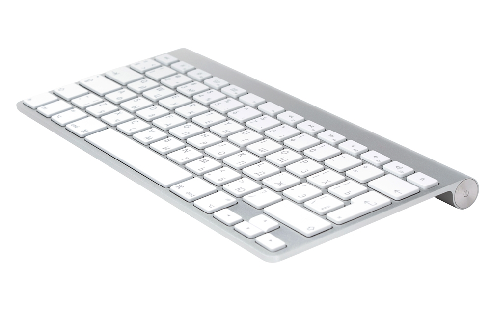

# LinAppleKey

[Русский](README_RU.md)



Linux user-space port of **WinAppleKey**: Apple Wireless Keyboard (A1314)
and Apple Magic Keyboard (A1644) remapping with a ThinkBook-like layout,
working Fn keys, media, volume, brightness and sleep.

This is a **user-space daemon**, not a kernel module. It reads raw HID
reports from `/dev/hidrawX`, takes the physical keyboard with `EVIOCGRAB`,
and emits translated events through `/dev/uinput`. No `linux-headers`, no
DKMS, no Secure Boot changes.


## Install

Requirements: `gcc`, `make`, systemd and `/dev/uinput`. On most systems the
`uinput` module is already loaded; if not:

```sh
sudo modprobe uinput
```

From the source tree:

```sh
sudo ./install.sh
```

The script builds `linapplekeyd` and installs:

- `/usr/local/bin/linapplekeyd`
- `/etc/systemd/system/linapplekeyd.service`
- `/etc/linapplekey.conf` (only if it does not exist yet)
- documentation in `/usr/local/share/doc/linapplekey/`

Then it enables and starts the service. An existing config is kept; use
`sudo ./install.sh --force-config` to replace it.

The service runs as root because it needs `/dev/hidraw*` and `/dev/uinput`.
The unit is constrained with `NoNewPrivileges`, `ProtectSystem=strict`,
`ProtectHome`, `RestrictAddressFamilies` and other systemd hardening.

Check:

```sh
systemctl status linapplekeyd
journalctl -u linapplekeyd -f
```

### Release build

```sh
make release
```

Builds, runs the test suite and writes `dist/linapplekey-<version>.tar.gz`
with a `.sha256` file. The archive contains sources and install scripts.

### Manual run

```sh
sudo ./build/linapplekeyd --no-power --start-delay 10
```

`--start-delay 10` gives you ten seconds to focus a window. Without
`--no-power`, Fn+F5/F6 can suspend or hibernate the machine.

## Keys

Hold the physical **Ctrl** key for the Fn combinations; that is what the
Fn/Ctrl swap is for. Left Option becomes Win, left Command becomes Alt.

| You press | You get |
| --- | --- |
| Ctrl+F1, Ctrl+F2 | brightness down, brightness up |
| Ctrl+F3 | Super+Tab, overview |
| Ctrl+F4 | Super+Z, tiling |
| Ctrl+F5 | sleep |
| Ctrl+F6 | hibernate |
| Ctrl+F7, F8, F9 | previous track, play/pause, next track |
| Ctrl+F10, F11, F12 | mute, volume down, volume up |
| Ctrl+← / → / ↑ / ↓ | Home / End / Page Up / Page Down |
| Ctrl+Return | Insert |
| Ctrl+P / S / B | Print Screen / Scroll Lock / Pause |
| Ctrl+Fn | Right Ctrl |

Eject is Delete. Right Option opens the context menu by default, right
Command acts as Alt. Any other Fn+key combination is swallowed.

## Configuration

`/etc/linapplekey.conf`, example in `linapplekey.conf.example`. Reload:

```sh
sudo systemctl reload linapplekeyd
```

or manually: `sudo kill -HUP $(pidof linapplekeyd)`.

| Key | Default | Meaning |
| --- | --- | --- |
| `SwapFnCtrl` | 1 | swap Fn and left Ctrl |
| `SwapAltCmd` | 1 | swap left Option and left Command |
| `RightCmdAsMenu` | 1 | one right-hand modifier becomes the menu key |
| `SwapRightCmdAlt` | 1 | 1: right Option = menu, right Command = Alt; 0: the other way |
| `SwapGraveBackslash` | 1 | swap the ISO grave/backslash pair |
| `DirectPowerAction` | 0 | 1: Fn+F5 via `systemctl suspend`; 0: native `KEY_SLEEP`. Fn+F6 always via `systemctl hibernate` |
| `Grab` | 1 | 1: exclusive `EVIOCGRAB`; 0: passthrough, no injection |
| `PowerKeys` | 1 | 0: ignore Fn+F5/F6 |

## Diagnostics

```sh
linapplekeyd --list-devices
linapplekeyd --doctor
sudo /usr/local/bin/linapplekeyd --self-test
sudo linapplekeyd --capture apple.cap --capture-duration 30
linapplekeyd --replay apple.cap
```

`--no-grab` is a pure passthrough: the daemon still reads hidraw but does not
inject anything, so the physical keyboard works without duplicates. Use the
normal grabbed mode to test remapping; `SIGUSR1` switches between the two at
runtime.

`-v` enables debug logs: every report byte and every uinput event. Each log
line has a level (`ERROR`, `WARN`, `INFO`, `DEBUG`), and a timestamp unless
stderr is journald (journald adds its own). When stderr is not a terminal,
debug output is rate-limited, so `-v` cannot flood the journal; in a terminal
it is unlimited.

## Uninstall

```sh
sudo ./uninstall.sh            # keep the config
sudo ./uninstall.sh --purge    # remove /etc/linapplekey.conf too
```

## Troubleshooting

Start with `linapplekeyd --doctor`: it shows permissions, uinput, netlink and detected keyboards.

**Keyboard not found.** `linapplekeyd --list-devices` should show
`0005:05AC:0256.*` (A1314) or an A1644 entry. If it is empty, check Bluetooth.

**No `/dev/uinput`.** `sudo modprobe uinput`; add `uinput` to
`/etc/modules-load.d/` if needed.

**Keyboard stopped typing.** The laptop's internal keyboard is never grabbed
and remains the emergency fallback. Stop the service:
`sudo systemctl stop linapplekeyd`.

**Fn+F5/F6 do nothing.** Check `PowerKeys`. With `DirectPowerAction=0`,
Fn+F5 uses native `KEY_SLEEP`; Fn+F6 always calls `systemctl hibernate`.
If hibernation fails, check `journalctl -u linapplekeyd -b` and run
`systemctl hibernate` manually: the kernel needs `disk` support and enough
swap.

**NumLock turns j/k/l into 1/2/3.** Update to a build that forwards only the
Caps Lock LED; older builds sent NumLock to the Apple keyboard.

**Option/Command swap is not visible in `--no-grab`.** Expected: the physical
keyboard is not grabbed, so KWin sees it directly. Test in the normal mode.

## Limitations

- A1314 is tested on real hardware; A1644 comes from WinAppleKey code and has
  not been tested on a live device here.
- Several Apple keyboards are supported: each has its own translator state
  and uinput device (up to 4). A live pair has not been tested: only one
  keyboard was available.
- The Fn layer looks at the first key slot, as in the Windows original.
- Brightness controls the internal panel; external monitors need DDC/CI.
