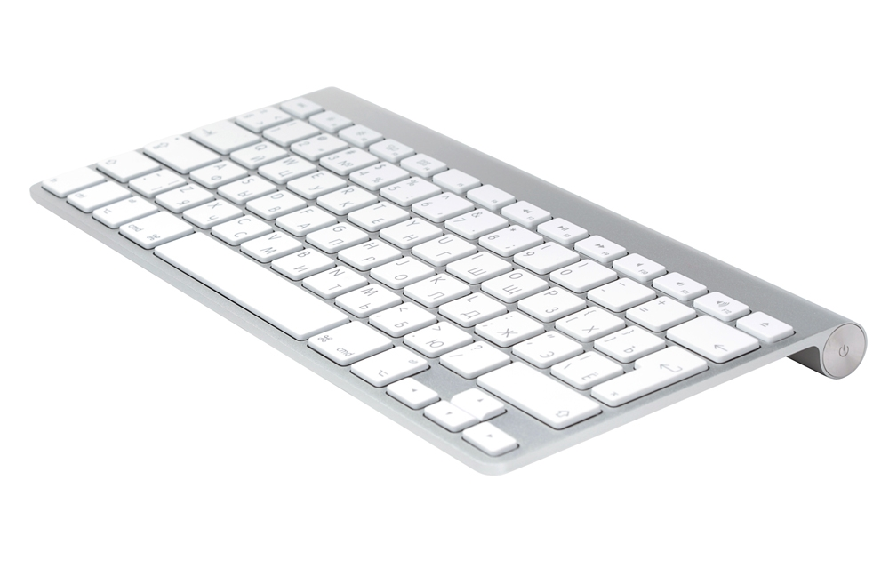

# LinAppleKey

[English](README.md)



Linux-порт **WinAppleKey**: переназначение Apple Wireless Keyboard (A1314)
и Apple Magic Keyboard (A1644) на раскладку в духе ThinkBook — с рабочими
Fn-клавишами, медиа, громкостью, яркостью и сном.

Это **user-space демон**, а не модуль ядра. Он читает сырые HID-отчёты из
`/dev/hidrawX`, забирает физическую клавиатуру через `EVIOCGRAB` и отдаёт
готовые события через `/dev/uinput`. Не нужны `linux-headers`, DKMS и
отключение Secure Boot.


## Установка

Нужны `gcc`, `make`, systemd и `/dev/uinput`. На большинстве систем модуль
`uinput` уже загружен; если нет:

```sh
sudo modprobe uinput
```

Из папки с исходниками:

```sh
sudo ./install.sh
```

Скрипт соберёт `linapplekeyd`, поставит:

- `/usr/local/bin/linapplekeyd`
- `/etc/systemd/system/linapplekeyd.service`
- `/etc/linapplekey.conf` (только если файла ещё нет)
- документацию в `/usr/local/share/doc/linapplekey/`

и запустит сервис. Если конфиг уже есть, он не перезаписывается; для
перезаписи: `sudo ./install.sh --force-config`.

Сервис работает от root: ему нужны `/dev/hidraw*` и `/dev/uinput`.
Юнит ограничен `NoNewPrivileges`, `ProtectSystem=strict`, `ProtectHome`,
`RestrictAddressFamilies` и другими опциями systemd.

Проверить:

```sh
systemctl status linapplekeyd
journalctl -u linapplekeyd -f
```

### Релизная сборка

```sh
make release
```

Собирает, запускает тесты и создаёт `dist/linapplekey-<version>.tar.gz`
плюс `.sha256`. В архиве исходники и скрипты установки.

### Ручной запуск без установки

```sh
sudo ./build/linapplekeyd --no-power --start-delay 10
```

`--start-delay 10` даёт 10 секунд, чтобы сфокусировать окно и приготовиться.
Без `--no-power` Fn+F5/F6 смогут отправить машину в сон.

## Клавиши

Комбинации Fn набираются с зажатым **физическим Ctrl** — для этого и сделан
свап Fn/Ctrl. Левый Option становится Win, левый Command — Alt.

| Ты нажимаешь | Ты получаешь |
| --- | --- |
| Ctrl+F1, Ctrl+F2 | яркость меньше, яркость больше |
| Ctrl+F3 | Super+Tab, обзор окон |
| Ctrl+F4 | Super+Z, раскладка окон |
| Ctrl+F5 | сон |
| Ctrl+F6 | гибернация |
| Ctrl+F7, F8, F9 | предыдущий трек, play/pause, следующий трек |
| Ctrl+F10, F11, F12 | mute, тише, громче |
| Ctrl+← / → / ↑ / ↓ | Home / End / Page Up / Page Down |
| Ctrl+Return | Insert |
| Ctrl+P / S / B | Print Screen / Scroll Lock / Pause |
| Ctrl+Fn | Right Ctrl |

Eject — это Delete. Правый Option по умолчанию открывает контекстное меню,
правый Command работает как Alt. Остальные Fn+клавиша намеренно
проглатываются.

## Настройки

Файл `/etc/linapplekey.conf`, пример — `linapplekey.conf.example`.
После изменения:

```sh
sudo systemctl reload linapplekeyd
```

или вручную: `sudo kill -HUP $(pidof linapplekeyd)`.

| Ключ | По умолчанию | Что делает |
| --- | --- | --- |
| `SwapFnCtrl` | 1 | меняет местами Fn и левый Ctrl |
| `SwapAltCmd` | 1 | меняет местами левые Option и Command |
| `RightCmdAsMenu` | 1 | один из правых модификаторов становится меню |
| `SwapRightCmdAlt` | 1 | 1: правый Option = меню, правый Command = Alt; 0: наоборот |
| `SwapGraveBackslash` | 1 | меняет местами ISO-пару `` ` `` / `\` |
| `DirectPowerAction` | 0 | 1: Fn+F5 через `systemctl suspend`; 0: native `KEY_SLEEP`. Fn+F6 всегда через `systemctl hibernate` |
| `Grab` | 1 | 1: эксклюзивный `EVIOCGRAB`; 0: passthrough, без инжекции |
| `PowerKeys` | 1 | 0: игнорировать Fn+F5/F6 |

## Диагностика

```sh
# какие Apple-клавиатуры найдены и куда они подключены
linapplekeyd --list-devices

# проверить права, /dev/uinput, netlink и найденные клавиатуры
linapplekeyd --doctor

# проверить виртуальную клавиатуру без hidraw и захвата
sudo /usr/local/bin/linapplekeyd --self-test

# снять сырые HID-отчёты (файл создаётся с правами 0600)
sudo linapplekeyd --capture apple.cap --capture-duration 30

# прогнать capture через ту же логику без устройств
linapplekeyd --replay apple.cap
```

`--no-grab` — чистый passthrough: демон по-прежнему читает hidraw, но ничего
не инжектит, поэтому физическая клавиатура работает без дублей. Для проверки
переназначения нужен обычный режим с захватом; `SIGUSR1` переключает режимы
на лету.

`-v` включает отладочные логи: каждый байт отчёта и каждое событие uinput.
Каждая строка содержит уровень (`ERROR`, `WARN`, `INFO`, `DEBUG`) и
timestamp, кроме journald — там время добавляет сам journald. Если stderr
не терминал, отладочный вывод ограничивается по скорости, поэтому `-v` не
заливает journal; в терминале ограничения нет.

## Удаление

```sh
sudo ./uninstall.sh            # конфиг остаётся
sudo ./uninstall.sh --purge    # удалить и /etc/linapplekey.conf
```

## Если что-то не работает

Начни с `linapplekeyd --doctor` — она покажет права, uinput, netlink и найденные клавиатуры.

**Клавиатура не находится.** `linapplekeyd --list-devices` должен показать
`0005:05AC:0256.*` (A1314) или A1644. Если пусто — проверь Bluetooth.

**Нет `/dev/uinput`.** `sudo modprobe uinput`; при необходимости добавь
`uinput` в `/etc/modules-load.d/`.

**Клавиатура перестала печатать.** Встроенная клавиатура ноутбука не
захватывается и остаётся аварийным выходом. Останови сервис:
`sudo systemctl stop linapplekeyd`.

**Fn+F5/F6 ничего не делают.** Проверь `PowerKeys`. Fn+F5 при
`DirectPowerAction=0` идёт native `KEY_SLEEP`; Fn+F6 всегда вызывает
`systemctl hibernate`. Если гибернация не работает, смотри
`journalctl -u linapplekeyd -b` и проверь `systemctl hibernate` вручную:
нужны поддержка `disk` и достаточный swap.

**NumLock превращает j/k/l в 1/2/3.** Обнови до версии, где LED-события
пересылаются только для Caps Lock; старые сборки отправляли NumLock на
Apple-клавиатуру.

**Свап Option/Command не виден в `--no-grab`.** Это нормально: физическая
клавиатура не захвачена, KWin видит её напрямую. Проверяй в обычном режиме.

## Ограничения

- A1314 проверен на реальном железе; A1644 — по коду WinAppleKey, без
  живой проверки.
- Несколько Apple-клавиатур поддерживаются: у каждой своё состояние и
  свой uinput (до 4). Живая пара не проверялась: доступна одна
  клавиатура.
- Fn-слой смотрит на первый слот клавиш, как в Windows-оригинале.
- Яркость управляет встроенной панелью; внешний монитор — это DDC/CI.
